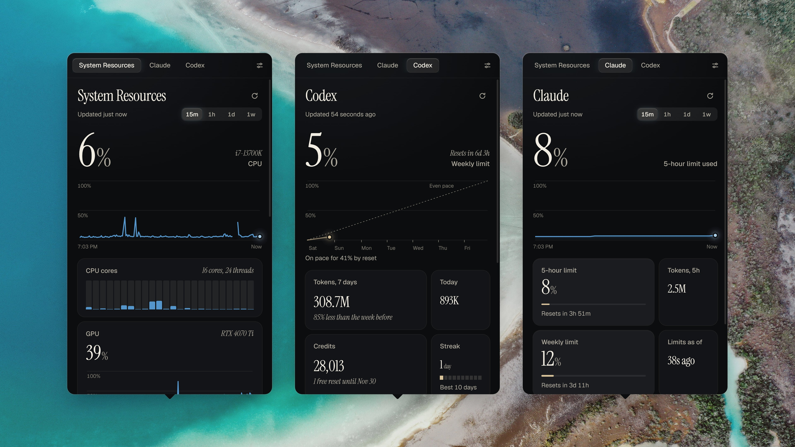
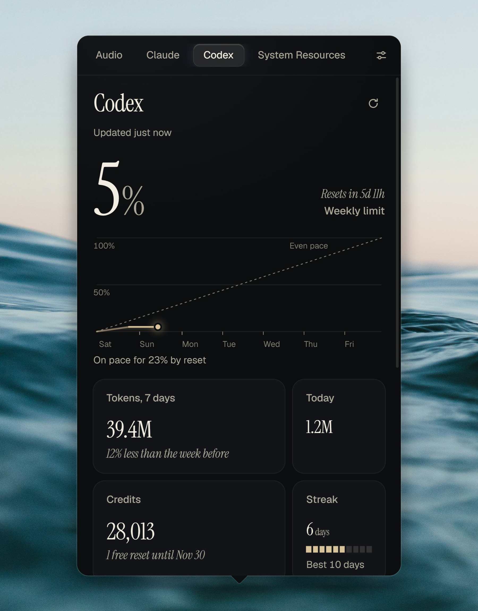
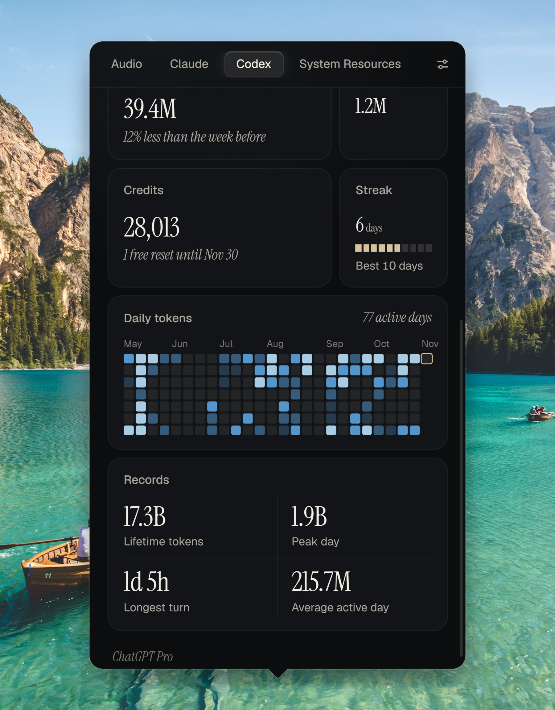
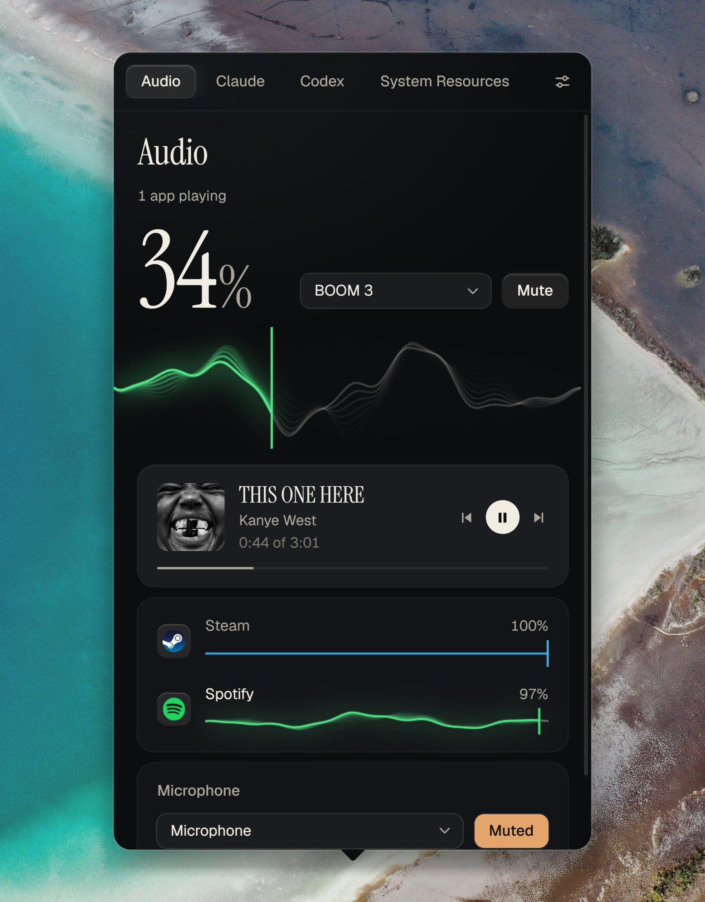
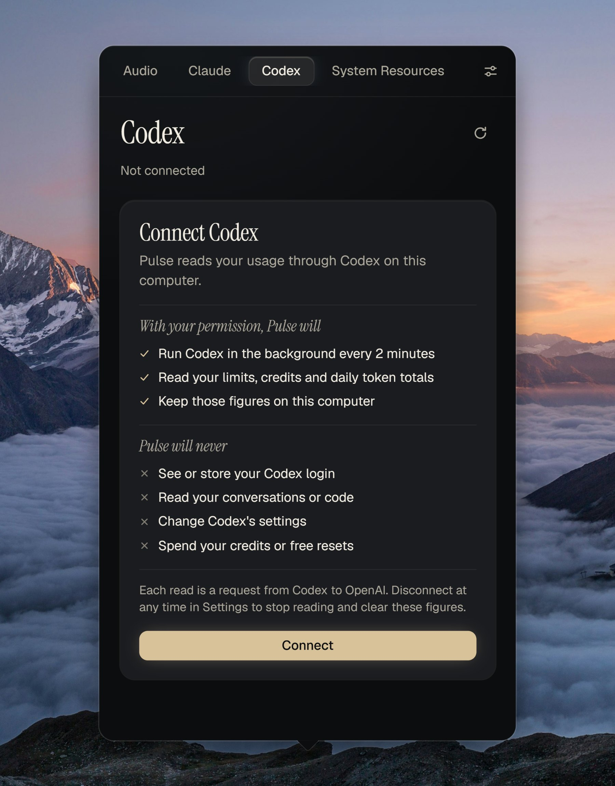
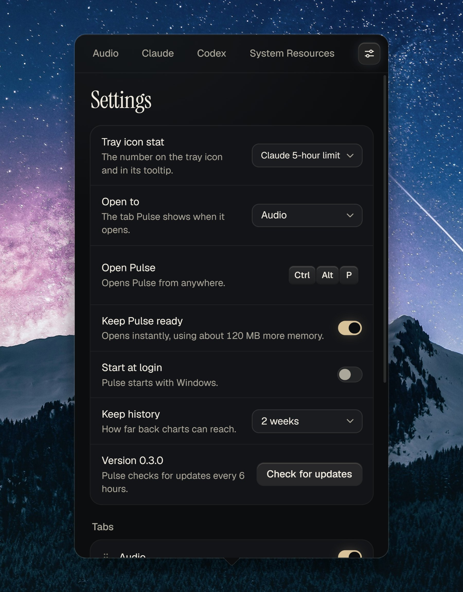

# Pulse

Everything you care about, in one tray app.

Pulse is a Windows tray app that shows your computer, your Claude limits, your Codex limits and your audio in one panel. Open it with a click or a shortcut. It's a free, open source alternative to CodexBar for Windows.



## Download

**[Download Pulse for Windows](https://github.com/k4rg1l/Pulse/releases/latest/download/Pulse-setup.exe)**

Installing needs no admin rights. Pulse opens by itself the first time, then stays in your tray. Press `Ctrl` `Alt` `P` to open it from anywhere.

Windows may show a SmartScreen notice because Pulse is a new app. Choose **More info**, then **Run anyway**. You can check your download against its [SHA-256 checksum](https://github.com/k4rg1l/Pulse/releases/latest/download/Pulse-setup.exe.sha256).

## What it shows

### System Resources

CPU, every core, memory, disks and network. GPU usage, memory and temperature appear on NVIDIA graphics cards. Any number can show on the tray icon.

### Claude

Your 5-hour and weekly limits, tokens used and a breakdown by model. Needs [Claude Code](https://claude.com/claude-code).

### Codex

Your limits, credits, free resets, streak, records and half a year of daily use. Needs [Codex](https://openai.com/codex/) signed in with ChatGPT.

<p>
  
  
</p>

The pace chart shows a limit across its whole window, against a line for even use. If you go over the line, Pulse shows when you would run out.

### Audio

Switch output and input devices, set the volume of each app, mute outputs, apps and the microphone, and control what is playing. Each app's line follows its own sound on Windows 11. Each app takes its colour from its icon, or from the album art while it plays music.



## Your data

Before Claude or Codex connects, Pulse lists what it will read and what it will never do. You can disconnect at any time in Settings.

<p>
  
  
</p>

- **Your figures stay on your computer.** Pulse has no account, no server and no analytics.
- **Pulse never sees your logins.** Claude data comes from what Claude Code keeps on your computer. Codex data comes through Codex itself, which contacts OpenAI using its own sign-in.
- **Conversations are never kept.** Claude transcripts are read to count tokens, and only the counts are stored.
- **Pulse checks GitHub for new versions.** That check sends none of your data, and an update installs only when you click Update.
- **Audio stays in memory.** While the Audio tab is open, Pulse reads the sound to measure its bass, mids and treble. Nothing about sound is saved or sent.

## Settings

- Choose the shortcut that opens Pulse.
- Choose the stat shown on the tray icon, and the tab Pulse opens to.
- Keep Pulse ready, which opens it instantly for about 120 MB more memory.
- Start at login.
- Keep history for 1 week, 2 weeks or 30 days.
- Choose which tabs show and their order. A hidden tab's source stops running.

## How we measured

One release build in November 2026, on Windows 11 with an i7-13700K, at default settings with Claude and Codex connected.

| | |
|---|---|
| Download | 4.6 MB |
| Memory with the panel closed | 34 MB |
| CPU with the panel closed | 0.03% of the whole machine, and higher on fewer cores |
| Time to open | 370 ms, or under 50 ms with Keep Pulse ready |
| Largest comparable download | [PulseBar](https://github.com/Hitbee-dev/PulseBar) at 96.7 MB, which is 21x larger |

## Build from source

You need [Node.js](https://nodejs.org), [pnpm](https://pnpm.io), [Rust](https://rustup.rs) and the [Tauri prerequisites for Windows](https://v2.tauri.app/start/prerequisites/).

```sh
pnpm install
pnpm tauri dev
```

To build the installer:

```sh
pnpm tauri build
```

Pulse is built with [Tauri](https://tauri.app), Rust and React. It has been tested on Windows 11.

## License

[MIT](LICENSE)
